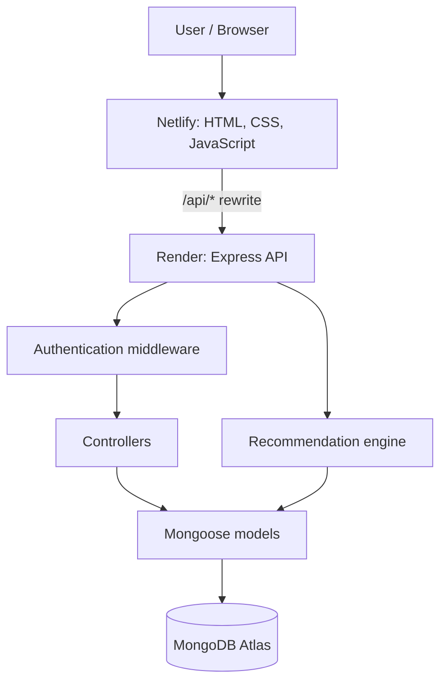

# MacroMatch 🥗

### Reverse your macros. Build your meal.

**MacroMatch** is a full-stack meal-planning web application that works backwards from a user's nutrition goals. Instead of choosing a food first and then checking its nutritional values, users enter the **calories, protein, carbohydrates, and fat** they want to target. MacroMatch searches its food database and recommends combinations of foods and portion sizes that come closest to those targets.

The application includes account authentication, a nutrition dashboard, food browsing, a meal recommendation calculator, saved meals, a personal pantry, daily meal logging, and progress tracking. User-specific information is stored in MongoDB and accessed through an Express API.

> **Live project:** [Open MacroMatch](https://macromatch-planner.netlify.app/)  
> **Backend service:** [macromatch-1.onrender.com](https://macromatch-1.onrender.com/)  
> **GitHub repository:** [parth2730/MacroMatch](https://github.com/parth2730/MacroMatch)

---

## Table of contents

- [Project overview](#-project-overview)
- [Features](#-features)
- [How MacroMatch works](#-how-macromatch-works)
- [Technology stack](#-technology-stack)
- [Architecture](#-architecture)
- [Project structure](#-project-structure)
- [Run the project locally](#-run-the-project-locally)
- [Environment variables](#-environment-variables)
- [API reference](#-api-reference)
- [Recommendation engine](#-recommendation-engine)
- [Database collections](#-database-collections)
- [Testing with Postman](#-testing-with-postman)
- [Deployment](#-deployment)
- [Troubleshooting](#-troubleshooting)
- [Security and data notes](#-security-and-data-notes)

---

## 🌟 Project overview

Many nutrition apps start with a food and tell users what nutrients it contains. MacroMatch approaches the problem from the other direction:

1. The user specifies a nutrition target.
2. The app considers the available food items and optional preferences.
3. The backend generates candidate food combinations and portion sizes.
4. Candidates are scored against the requested macro target.
5. The app returns ranked meal suggestions so the user can choose one to save or log.

The frontend is built with standard **HTML, CSS, and JavaScript**. The backend uses **Node.js, Express, and Mongoose**, while **MongoDB Atlas** stores application data.

## ✨ Features

### Account and session management

- Sign up and log in with server-side validation.
- Passwords are hashed with `bcryptjs` rather than stored as plain text.
- Server-side sessions are stored in MongoDB using `express-session` and `connect-mongo`.
- A protected current-user endpoint supports authentication-aware pages.
- Logout destroys the current session.

### Macro-based meal recommendations

- Enter target calories, protein, carbohydrates, and fat.
- Generate ranked combinations of foods with portion sizes.
- Filter recommendations by meal type and diet preference.
- Optionally limit recommendations to foods in the user's pantry.
- Review the returned candidate scores and macro match information.

### Food explorer

- Browse the food database.
- Search foods by name.
- Filter by category, diet, or meal type.
- Open an individual food record by its ID.

### Dashboard and progress

- Review daily macro goals and meal totals.
- See logged meals and saved meals.
- Track progress against daily targets.
- View daily and weekly progress information.

### Personal pantry

- Mark foods the user already has available.
- Add or remove a food from the pantry.
- Persist pantry selections per user.
- Use pantry contents to constrain recommendations.

### Meal management

- Save a generated meal for later.
- Add meals to the daily log.
- Retrieve log entries and totals by date.
- Remove saved meals or logged entries.

---

## 🔄 How MacroMatch works

A typical user flow looks like this:

1. **Create an account or log in.** The backend validates credentials and creates a server-side session.
2. **Set daily goals.** The user can view or update calorie and macro targets.
3. **Explore foods or build a target.** The food explorer helps users inspect available ingredients; the calculator accepts a desired macro profile.
4. **Generate recommendations.** The backend filters candidate foods and evaluates possible combinations.
5. **Save or log a meal.** Selected meals can be bookmarked or added to the user's meal log.
6. **Review progress.** The dashboard and progress page use saved goals and meal-log data to calculate progress.

---

## 🧰 Technology stack

| Layer | Technology | Role |
|---|---|---|
| Frontend | HTML5, CSS3, vanilla JavaScript | Pages, forms, client-side interactions |
| API server | Node.js, Express | HTTP server and API routes |
| Architecture | MVC-style separation | Routes, controllers, and data models have separate responsibilities |
| Database access | Mongoose | MongoDB schemas and database queries |
| Database | MongoDB Atlas / MongoDB | Users, sessions, foods, goals, pantry items, saved meals, and meal logs |
| Authentication | `express-session`, `connect-mongo` | Server-side session management |
| Password hashing | `bcryptjs` | Hash passwords before storing them |
| API testing | Postman | Test requests, authentication, and JSON responses |
| Frontend hosting | Netlify | Public website hosting |
| Backend hosting | Render | Public Express API hosting |

---

## 🏗️ Architecture

In production, the frontend and backend are deployed separately. The frontend sends requests to `/api/...`; Netlify's rewrite forwards those API requests to the Render service. This keeps the browser-facing API path on the frontend's origin, which is useful for session-cookie behaviour.



### MVC responsibilities

- **Model:** Defines the data structures and database operations, such as `User`, `Food`, `Goal`, `PantryItem`, `MealLog`, and `SavedMeal`.
- **View:** The frontend pages and client-side JavaScript present information and collect user input.
- **Controller:** Handles request logic, validation, and coordination with models.
- **Route:** Maps an HTTP method and URL to the appropriate controller function.
- **Middleware:** Performs cross-cutting tasks such as checking whether a request has an authenticated session.

The recommendation engine and helper utilities live under `backend/lib/` because they provide reusable application logic rather than defining HTTP routes.

---

## 🗂️ Project structure

```text
MacroMatch/
├── backend/
│   ├── server.js
│   ├── package.json
│   ├── config/
│   │   └── db.js
│   ├── controllers/
│   │   ├── authController.js
│   │   ├── foodController.js
│   │   ├── goalController.js
│   │   ├── mealController.js
│   │   ├── pantryController.js
│   │   └── recommendationController.js
│   ├── data/
│   │   └── foods.json
│   ├── lib/
│   │   ├── helpers.js
│   │   ├── recommendationEngine.js
│   │   └── seedFoods.js
│   ├── middleware/
│   │   └── requireAuth.js
│   ├── models/
│   │   ├── User.js
│   │   ├── Food.js
│   │   ├── Goal.js
│   │   ├── PantryItem.js
│   │   ├── MealLog.js
│   │   └── SavedMeal.js
│   └── routes/
│       ├── auth.js
│       ├── foods.js
│       ├── goal.js
│       ├── pantry.js
│       ├── meals.js
│       └── recommendations.js
├── frontend/
│   ├── _redirects
│   ├── index.html
│   ├── signup.html
│   ├── login.html
│   ├── dashboard.html
│   ├── calculator.html
│   ├── foods.html
│   ├── progress.html
│   ├── css/
│   └── js/
│       ├── api.js
│       ├── auth.js
│       ├── foodDatabase.js
│       ├── pantryStorage.js
│       ├── mealStorage.js
│       ├── calculator.js
│       ├── dashboard.js
│       ├── foods.js
│       └── progress.js
└── README.md
```

> This is the intended high-level structure. If a local branch contains additional files, keep those files in the repository as appropriate; do not delete files simply because they are not listed here.

---

## 🚀 Run the project locally

### Prerequisites

- Node.js and npm installed.
- Access to a MongoDB database (MongoDB Atlas is supported).
- Git, if cloning the repository.

### 1. Clone the repository

```bash
git clone https://github.com/parth2730/MacroMatch.git
cd MacroMatch
```

### 2. Install backend dependencies

```bash
cd backend
npm install
```

### 3. Create the environment file

Create a file named `.env` inside the `backend/` directory:

```env
MONGO_URI=mongodb+srv://<username>:<password>@<cluster>/<database>
SESSION_SECRET=replace-with-a-long-random-secret
PORT=5055
```

Replace the placeholders with your own MongoDB connection string and a strong random session secret. Do not commit `.env` to GitHub.

### 4. Start the backend

For development with automatic restarts:

```bash
npm run dev
```

Or run the production start script:

```bash
npm start
```

The local server is configured to use port `5055` by default. When startup succeeds, open:

- Local app (when served by Express): `http://localhost:5055`
- Local API base: `http://localhost:5055/api`

The food seed data is loaded by the backend startup process, so a manual seed command is not normally required.

### 5. Confirm local connectivity

A quick check is to send a `GET` request to:

```text
http://localhost:5055/api/foods
```

For protected endpoints, log in first using Postman or the frontend so the session cookie is established.

---

## 🔐 Environment variables

| Variable | Required | Purpose |
|---|---|---|
| `MONGO_URI` | Yes | MongoDB connection string |
| `SESSION_SECRET` | Yes | Secret used to sign session IDs |
| `PORT` | Local default | Local server port; defaults to `5055` when not provided |

### Production environment

Set `MONGO_URI` and `SESSION_SECRET` in the Render service's environment settings. Let the hosting platform provide its port unless the service's configuration specifically requires otherwise. Never paste secrets into source files, README examples, commits, screenshots, or public chats.

---

## 🔌 API reference

All API responses are JSON. Signup and login create a session; logout destroys it. The current-user route and user-specific application routes require a valid session. In Postman, send the login request first and allow Postman to retain the returned session cookie before testing protected routes.

**Production API base:** `https://macromatch-1.onrender.com/api`  
**Local API base:** `http://localhost:5055/api`

### Authentication

| Method | Endpoint | Description | Authentication |
|---|---|---|---|
| `POST` | `/api/auth/signup` | Create a user account and start a session | Public |
| `POST` | `/api/auth/login` | Verify credentials and start a session | Public |
| `POST` | `/api/auth/logout` | Destroy the current session | Active session |
| `GET` | `/api/auth/me` | Return the currently authenticated user | Required |

Example login body:

```json
{
  "email": "you@example.com",
  "password": "your-password"
}
```

Example signup body:

```json
{
  "name": "Example User",
  "email": "you@example.com",
  "password": "use-a-strong-password"
}
```

### Foods

| Method | Endpoint | Description |
|---|---|---|
| `GET` | `/api/foods` | List foods; supports `search`, `category`, `diet`, and `mealType` query parameters |
| `GET` | `/api/foods/:id` | Get a single food by its ID |

Example filtered request:

```text
GET /api/foods?search=egg&diet=vegetarian
```

### Daily goals

| Method | Endpoint | Description |
|---|---|---|
| `GET` | `/api/goal` | Get the current user's daily macro goal (or the default goal when unset) |
| `PUT` | `/api/goal` | Update the current user's daily macro goal |

Example update body:

```json
{
  "calories": 2200,
  "protein": 120,
  "carbs": 250,
  "fat": 70
}
```

Use your own targets when updating a real account. These numbers are examples only.

### Pantry

| Method | Endpoint | Description |
|---|---|---|
| `GET` | `/api/pantry` | Get the current user's pantry food IDs |
| `PUT` | `/api/pantry` | Replace the pantry list |
| `POST` | `/api/pantry/:foodId/toggle` | Add a food to or remove a food from the pantry |
| `DELETE` | `/api/pantry/:foodId` | Remove a food from the pantry |

Example `PUT /api/pantry` body:

```json
{
  "foodIds": ["food-id-1", "food-id-2"]
}
```

Use IDs returned by the Foods API; the IDs above are placeholders.

### Meal log

| Method | Endpoint | Description |
|---|---|---|
| `GET` | `/api/meals/log` | Get meal-log entries; optionally filter by `?date=YYYY-MM-DD` |
| `GET` | `/api/meals/log/totals` | Get daily nutrition totals; optionally filter by `?date=YYYY-MM-DD` |
| `POST` | `/api/meals/log` | Add a meal to the current user's log |
| `DELETE` | `/api/meals/log/:logId` | Delete a logged meal by its log ID |

Example meal-log body:

```json
{
  "signature": "example-meal-log-001",
  "name": "Lunch bowl",
  "mealType": "lunch",
  "dietLabel": "vegetarian",
  "itemCount": 1,
  "items": [
    {
      "id": "food-id-1",
      "name": "Example food",
      "unit": "g",
      "quantity": 100,
      "calories": 150,
      "protein": 8,
      "carbs": 20,
      "fat": 4
    }
  ],
  "totals": {
    "calories": 150,
    "protein": 8,
    "carbs": 20,
    "fat": 4
  }
}
```

This is an illustrative body. Use a valid food ID and nutrition values appropriate to your test. If you create test records in the live account, remove them after testing.

### Saved meals

| Method | Endpoint | Description |
|---|---|---|
| `GET` | `/api/meals/saved` | List the current user's saved meals |
| `POST` | `/api/meals/saved` | Save a meal for later |
| `DELETE` | `/api/meals/saved/:savedId` | Remove a saved meal |

The saved-meal body uses the meal fields shown above, including a meal name and a signature. Use a unique signature for a new test meal.

### Recommendations

| Method | Endpoint | Description |
|---|---|---|
| `POST` | `/api/recommendations` | Generate ranked meal candidates from a nutrition target |

Example request body:

```json
{
  "calories": 600,
  "protein": 40,
  "carbs": 60,
  "fat": 20,
  "mealType": "lunch",
  "diet": "vegetarian",
  "maxItems": 3,
  "useWhatIHave": true
}
```

- `calories`, `protein`, `carbs`, and `fat` describe the desired target.
- `mealType` can narrow the food candidates to a meal type.
- `diet` can be used to apply a diet preference.
- `maxItems` controls how many food items can be considered in a candidate combination.
- `useWhatIHave` asks the engine to use foods from the current user's pantry when enabled.

---

## 🧠 Recommendation engine

The recommendation engine runs on the backend in `backend/lib/recommendationEngine.js`. Its high-level process is:

1. Filter foods using diet, meal-type, and pantry selections when applicable.
2. Build a candidate pool, initially sorted using protein per calorie.
3. Generate combinations containing between one and the configured maximum number of food items.
4. Adjust portion sizes using increments such as 25 grams or half-pieces, depending on the food unit.
5. Score combinations across four target dimensions:

   ```text
   score = 0.30 × calorieMatch
         + 0.35 × proteinMatch
         + 0.20 × carbMatch
         + 0.15 × fatMatch
   ```

6. Mark candidates within approximately ±8% of every requested target, rank candidates, and return the best matches (up to five suggestions).

The score is a ranking heuristic for the application; it is not a medical assessment or a guarantee that a meal is nutritionally ideal for every person.

---

## 💾 Database collections

| Collection | Purpose |
|---|---|
| `users` | Account records, including password hashes |
| `sessions` | Server-side session records managed by `connect-mongo` |
| `foods` | Food catalog seeded from the local food JSON data |
| `goals` | Daily macro goals associated with users |
| `pantryitems` | Foods marked as available by each user |
| `meallogs` | Meals recorded in a user's daily log |
| `savedmeals` | Meals a user has saved for later |

User-specific records are associated with the authenticated user. The browser should use the API as the source of truth for persistent application data rather than treating local browser storage as the database.

---

## 🧪 Testing with Postman

A convenient manual test sequence is:

1. `POST /api/auth/login` — log in with a test account.
2. `GET /api/auth/me` — confirm the session identifies the current user.
3. `GET /api/foods` — retrieve the food list.
4. `GET /api/goal` and `PUT /api/goal` — inspect and update goals. Use your existing values if you do not intend to change them.
5. `POST /api/recommendations` — request ranked meal suggestions.
6. `GET /api/meals/saved` and `GET /api/meals/log` — retrieve persisted meal data.
7. Test `POST` and `DELETE` operations only with clearly named test data, and delete test records when finished.
8. `POST /api/auth/logout`, then call `GET /api/auth/me` again to confirm the session is no longer authenticated.

### Important Postman notes

- Use the same hostname for login and protected requests. Local cookies for `localhost` are separate from cookies for the Render domain.
- Postman should retain the session cookie from the login response in its cookie jar. If a protected request returns `401 Unauthorized`, check the cookie jar and log in again.
- Use the direct Render URL for production Postman tests. The Netlify `/api` rewrite is intended for browser traffic from the deployed frontend.
- Avoid including real passwords, session cookies, database credentials, or secret environment values in screenshots or shared collections.

---

## ☁️ Deployment

### Current live services

| Component | Hosting | URL |
|---|---|---|
| Frontend | Netlify | [macromatch-planner.netlify.app](https://macromatch-planner.netlify.app/) |
| Backend API | Render | [macromatch-1.onrender.com](https://macromatch-1.onrender.com/) |
| Database | MongoDB Atlas | Managed database; connection string is private |

### Frontend API rewrite

The file `frontend/_redirects` should be deployed alongside `index.html` and should contain the following rewrite:

```text
/api/* https://macromatch-1.onrender.com/api/:splat 200
```

The frontend's API client should use the relative API base `/api` so requests are handled by the Netlify rewrite. If the API URL or hosting domain changes, update the configuration and test login/session behaviour after deployment.

### Deploying frontend changes

The current frontend workflow has used Netlify's manual deploy/drop flow. If the site is still configured that way:

1. Save the frontend files locally.
2. Ensure `frontend/_redirects` is present beside `index.html`.
3. Upload **only the `frontend/` folder**, not the repository's parent folder or backend folder.
4. Wait for the Netlify deploy status to show `Published`.
5. Open the live site, hard-refresh, and test login, food browsing, and meal persistence.

If the Netlify site is later connected directly to GitHub, configure its publish directory and build settings to match the project and use the Git-connected deployment workflow instead.

### Deploying backend changes

1. Commit and push backend changes to the branch connected to the Render service.
2. Confirm Render has started a deployment for the intended commit (if auto-deploy is enabled).
3. Wait for the deployment to become live and review logs if it fails.
4. Test a public endpoint and then test login and protected endpoints with Postman.
5. Verify the live frontend still works after backend changes.

Set production secrets in Render's environment settings. Do not store production secrets in the repository.

---

## 🛠️ Troubleshooting

| Symptom | Things to check |
|---|---|
| `401 Unauthorized` | Log in first; confirm Postman retained the session cookie; make sure the request uses the same host as the login request. |
| Browser request shows a CORS or network error | Confirm `frontend/_redirects` is deployed at the frontend root and that the frontend is calling `/api/...`. |
| `404 Not Found` | Check spelling, HTTP method, and endpoint path. Compare the URL with the API reference above. |
| `500 Internal Server Error` | Review the local terminal or Render logs; check environment variables, model names, and database connectivity. |
| MongoDB connection fails | Verify `MONGO_URI`, the database user/password, and the Atlas network-access configuration. Never expose the connection string in public logs or screenshots. |
| Frontend still shows an older version | Check the latest Netlify deploy status, re-upload the correct `frontend/` folder if using manual deploys, and hard-refresh the browser. |
| Local port is already in use | Change the local `PORT` value or stop the process occupying the port. The project defaults to `5055` to avoid common macOS port conflicts. |

---

## 🔒 Security and data notes

- Keep `backend/.env` out of Git. Use environment settings on the hosting provider for production secrets.
- Never store plain-text passwords; use the existing password-hashing flow.
- Do not share passwords, session cookies, `SESSION_SECRET`, or `MONGO_URI` in screenshots, public issues, or README content.
- Protected routes should use the authentication middleware before returning or changing user-specific records.
- Use temporary, clearly labelled records for testing `POST` and `DELETE` endpoints; clean them up after the test.
- Nutrition values are based on the app's food dataset and should be treated as estimates for planning, not as medical advice.

---

## 📌 Project summary

MacroMatch brings meal recommendation, food discovery, pantry management, saved meals, nutrition targets, and meal tracking into one full-stack web application. Its API-driven design separates the frontend from the backend, while the MVC-style organization makes route handling, business logic, and data access easier to understand and maintain.

**Live app:** [macromatch-planner.netlify.app](https://macromatch-planner.netlify.app/)  
**Source code:** [github.com/parth2730/MacroMatch](https://github.com/parth2730/MacroMatch)
